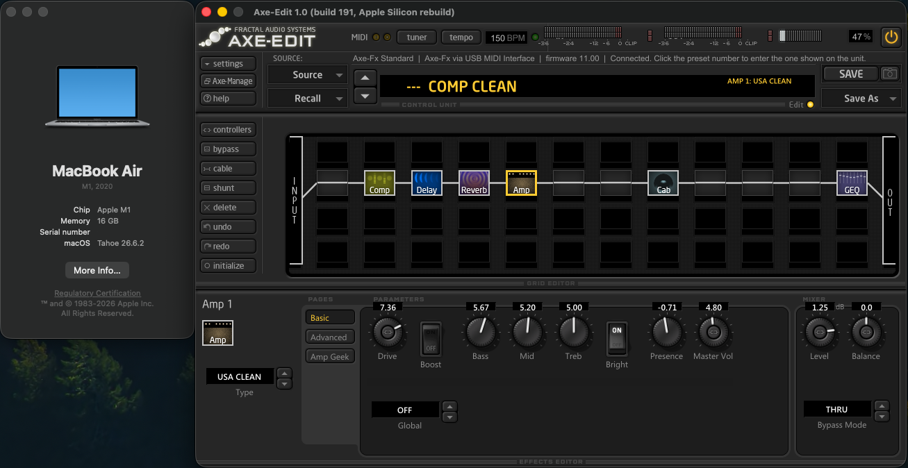

# Axe-Edit 1.0.191 — Apple Silicon rebuild

**DISCLAIMER** This was created fully by [Reverse Engineer Anything](https://github.com/morluto/rea). I haven't had time to review the code myself yet but the basic functionality that I've tested work.

A native arm64 reconstruction of the Axe-Edit 1.0 (build 191) editor for the **Axe-Fx Standard and Ultra**.
The original binary is i386 + PowerPC only (Carbon, JUCE 1.52), so it cannot run on Apple Silicon under Rosetta 2.

The app is rebuilt on current JUCE and is driven by the original installer's data files, copied unchanged from
`original/MacOS` into the bundle: skin (`Skins/Default/AE.saxey` + `AE.paxege`), configs, parameter profiles, factory banks.

## Installing Axe-Edit (for users)

You don't need any programming knowledge for this. It takes about five minutes.

### What you need

- **A Mac with Apple Silicon** (M1, M2, M3, M4 or newer). To check, open the Apple menu  in the top-left corner
  and choose **About This Mac**. The line called **Chip** should start with "Apple M". This version does not run on
  older Macs with an Intel processor.
- **macOS 11 (Big Sur) or newer.** About This Mac shows your macOS version too.
- **The installer file**, `Axe-Edit-arm64-1.0.191.dmg`, from whoever shared this app with you.
- To talk to the Axe-Fx: **a USB MIDI interface** with MIDI In and MIDI Out cables (the Axe-Fx Standard and Ultra
  have 5-pin MIDI sockets, not USB). You can still open and edit preset files without one.

### Step 1: Put the app in your Applications folder

1. Double-click `Axe-Edit-arm64-1.0.191.dmg` (it is usually in your **Downloads** folder).
   A window opens showing **Axe-Edit**, an **Applications** folder shortcut, and a short read-me.
2. **Drag the Axe-Edit icon onto the Applications folder** in that window and let go. This copies the app to your Mac.
3. Close the window. In the Finder sidebar, click the eject button (⏏) next to **Axe-Edit 1.0.191**.
   You can now delete the `.dmg` file if you like; the app has been copied.

### Step 2: Opening it the first time

This app is not distributed through Apple, so macOS asks you to approve it once:

1. Open your **Applications** folder (in Finder, choose **Go → Applications**) and double-click **Axe-Edit**.
2. macOS says it can't verify that "Axe-Edit" is free of malware. Click **Done** (not "Move to Trash").
3. Open the Apple menu  → **System Settings** → **Privacy & Security**. Scroll down to the **Security** section.
   There is a message about Axe-Edit being blocked. Click **Open Anyway**, then enter your Mac password
   (or use Touch ID).
4. Click **Open Anyway** once more in the window that appears.

From then on Axe-Edit opens normally, from Applications, Launchpad or Spotlight (press ⌘-Space and type "Axe-Edit").
To keep it in the Dock, right-click its Dock icon while it's running and choose **Options → Keep in Dock**.

On macOS 14 (Sonoma) or older you can instead **right-click** (or Control-click) Axe-Edit in Applications,
choose **Open**, and then click **Open** in the warning.

### Step 3: Connect your Axe-Fx

1. Connect the MIDI interface to your Mac. Plug its **MIDI Out** cable into the Axe-Fx's **MIDI In**, and its
   **MIDI In** cable into the Axe-Fx's **MIDI Out**. (The cables are often labelled the opposite way round;
   if nothing works, swap them.)
2. Switch the Axe-Fx on. If its MIDI settings have an option that blocks SysEx messages, make sure SysEx is allowed.
3. In Axe-Edit, click the **Settings** button (the power button opens the same menu).
   - Under **MIDI Input**, choose your MIDI interface.
   - Under **MIDI Output**, choose your MIDI interface.

   Axe-Edit connects by itself. The status line shows "Looking for an Axe-Fx..." and then the Axe-Fx's
   firmware version. If it says "No reply from an Axe-Fx", see *Troubleshooting* below.
4. The Standard/Ultra can't tell the editor which preset number it's on. Click the preset number in Axe-Edit and
   type the number shown on the Axe-Fx; after that it follows along.

### Step 4: Back up your presets (do this first!)

Before you change anything on the Axe-Fx, save a copy of everything on it:

1. Click the **Axe-Manage** button to open the librarian.
2. Click **Sync & Backup** and choose **All Banks**. Each bank takes about a minute and a half; don't play
   or press buttons on the Axe-Fx meanwhile.
3. The backup is saved in your **Documents** folder, in **Axe-Edit Backups**. Keep it somewhere safe.

### Updating to a newer version

Quit Axe-Edit, then repeat Step 1 with the new `.dmg`. When macOS asks whether to replace the existing Axe-Edit,
click **Replace**. Your settings and backups are kept. You may need to approve the new version once more (Step 2).

### Uninstalling

Drag **Axe-Edit** from the Applications folder to the Trash. To also remove its settings, open Finder, choose
**Go → Go to Folder...**, type `~/Library/Application Support` and delete `Axe-Edit-arm64.settings` and the
`Axe-Edit-arm64` folder. Your backups in Documents → Axe-Edit Backups are not touched; delete them yourself if you
no longer want them.

### Troubleshooting

- **"Axe-Edit is damaged and can't be opened. You should move it to the Trash."** This happens to some
  downloaded apps that aren't distributed through Apple; the app is not actually damaged. Open the **Terminal** app
  (Applications → Utilities → Terminal), paste the following line, press Return, and open Axe-Edit again:

      xattr -dr com.apple.quarantine /Applications/Axe-Edit.app

- **"You can't open the application because it is not supported on this type of Mac."** The Mac has an Intel
  processor; this version only runs on Apple Silicon.
- **The MIDI interface isn't in the MIDI Input / Output lists.** Unplug it and plug it back in, then open the Settings
  menu again. Some interfaces need a driver from their manufacturer's website; check that it shows up in the
  **Audio MIDI Setup** app (Applications → Utilities → Audio MIDI Setup → Window → Show MIDI Studio).
- **"No reply from an Axe-Fx."** Check that the two MIDI cables aren't swapped, that the Axe-Fx is switched on,
  and that SysEx isn't blocked in its MIDI settings. Then choose **Connect** from the Settings menu again.
- **Downloads or uploads stop part-way.** Use a dedicated MIDI interface rather than a MIDI port on another
  device, don't use the Axe-Fx during the transfer, and try again. Report what happened to whoever shared the app.

## Making the installer (for the person sharing the app)

    tools/make-dmg.sh

This builds the app, signs it, and writes `dist/Axe-Edit-arm64-1.0.191.dmg`, which contains the app, an
**Applications** shortcut and a short read-me. That one file is all other people need. Send it through any
file-sharing service; users then follow *Installing Axe-Edit* above.

The app is signed "ad hoc" (no paid Apple Developer account), which is why users have to approve it once in
Privacy & Security. To avoid that step, sign with a Developer ID certificate and notarize the disk image with
`xcrun notarytool`.

The app contains the data files from Fractal Audio's original Axe-Edit 1.0.191 installer. Only share it with
people who could use the original.

## Building from source

You need:

- **Xcode** from the Mac App Store (or just its command-line tools: run `xcode-select --install` in Terminal).
- **CMake** 3.22 or newer and **Ninja**, for example via [Homebrew](https://brew.sh): `brew install cmake ninja`.
- This folder, which already includes JUCE 8.0.4 (`JUCE/`) and the original installer's data (`original/`).

Then, in Terminal, from this folder:

    cmake -B build -G Ninja -DCMAKE_BUILD_TYPE=Release
    cmake --build build
    codesign --force --deep -s - "build/AxeEdit_artefacts/Release/Axe-Edit.app"

The app is at `build/AxeEdit_artefacts/Release/Axe-Edit.app`. To install your own build, drag it into
Applications (or run `tools/make-dmg.sh` and use the disk image).

### Tests (no window needed)

    APP="build/AxeEdit_artefacts/Release/Axe-Edit.app/Contents/MacOS/Axe-Edit"
    "$APP" --selftest original/MacOS/Banks              # round trips, edits, CSV, modifiers, graphs, CPU estimate
    "$APP" --simtest original/MacOS/Banks               # librarian + MIDI features against a simulated Ultra (about 5 min)
    "$APP" --snapshot out.png --file bank.syx --preset 0 --effect 106 [--page 1]
    "$APP" --snapshot-manage out.png --file bank.syx    # renders the Axe-Manage window
    "$APP" --snapshot-modifier out.png --file bank.syx --preset 45 --effect 131 --param 200

`--selftest` re-encodes every factory bank byte for byte, round-trips each of the 640 presets through CSV, attaches
and edits a modifier, and checks the graph maths (low-pass, peaking and shelf responses) and the CPU estimate.

`--simtest` starts `--axesim` (a simulated Axe-Fx Ultra on virtual MIDI ports, answering like the firmware code
recovered from the original) in a separate process. It checks every librarian transfer by reading it back, then
restarts the simulator and checks the modifier message, the tap-tempo CC, incoming tempo beats and a firmware update (a synthetic 60 kB file, which
the simulator "installs" as version 11.01). Set `AXE_SIMTEST_QUICK=1` to run only these editor checks (about 30 s).

## What works

- Opening, editing and saving Standard/Ultra bank (`.syx`, 128 presets) and single-preset files.
- Routing grid: insert/replace/move/delete blocks, shunts, cables (drag block to block in the next column), bypass, undo/redo, initialize.
- Effect editor: all pages, knobs, switches, faders and dropdowns from the original config, including type-dependent layouts.
- MIDI (Settings button): firmware query, read/send the edit-buffer preset, live parameter changes, store to a preset slot, tuner.
- Preset number: the Standard/Ultra can't report which preset it is on; click the number to enter it, after which
  up/down and incoming program changes keep it in step.
- **Modifiers.** Knobs, faders, switches and menus that can take a modifier show the modifier symbol (lit when one is
  attached). Click the symbol (or right-click the control) to open the modifier editor: source (LFO 1A-2B, ADSR 1-2,
  Sequencer, Envelope, Pitch, Extern 1-8 or none), start/mid/end, slope, scale, offset, damping, auto-engage, PC reset
  and off value, with the response curve. Changes are stored in the preset (17 modifier slots, as in the firmware)
  and sent to the unit with the MODIFIER_SET message. Setting the source to "none" detaches it.
- **Graphs.** The Filter, Parametric EQ and Controllers ADSR pages draw their curve in the monitor, computed like the
  firmware's own code (biquad responses at 64 log-spaced points from 20 Hz to 20 kHz; the ADSR envelope).
- **Tempo.** The BPM field shows the preset's tempo (click it to type one). The tempo button is tap tempo: every
  click sends the tap-tempo CC (14 by default, Settings > Tap Tempo CC) and two clicks set the preset's tempo.
  The LED blinks on the beats the unit sends, or at the preset's tempo when it sends none.
- **CPU.** The CPU meter and field show the original's estimate: each block's cost from the firmware model
  (Amp 24, Vocoder 13, Reverb 10 or 5 for the plates, ...) summed over the grid.
- **Meters.** As in the original, the input/output meters and clip LEDs show audio passing through the Mac:
  Settings > Audio Settings > "Pass audio through" chooses an audio interface; the pins on the meters set the input
  and output level. (They never showed levels from inside the Axe-Fx; the Standard/Ultra doesn't send any.)
- **CSV.** Save As > Export Preset as CSV, Source > Import Preset from CSV, and "Export as CSV" in Axe-Manage, in the
  original's CSV layout (version, name, grid, 17 modifiers, then every block's parameters).
- **Firmware update** (Settings > Update Firmware): sends a Fractal firmware `.syx` file message by message, with
  nothing else allowed out meanwhile, waits for the unit to install it and confirms the new version, like the
  original's updater.

## Axe-Manage (librarian)

Opened with the Axe-Manage button on the control unit.

- Sources: the unit's banks A, B and C (384 presets), its ten USER cab slots, and any bank files, preset files or
  folders of preset files you open (or drop on the window).
- Download a bank, all banks or selected presets; upload edited presets, selected presets or a whole bank;
  Sync & Backup writes freshly downloaded banks to `~/Documents/Axe-Edit Backups/<model> <date>/`.
- Each preset on the unit is marked Unknown (never downloaded), Synced or Edited (changed here, not yet sent).
- Copy, cut, paste over / paste insert, clear, rename, drag to reorder (Shift-drag swaps, Option-drag copies),
  drag between sources, undo/redo per source, save banks as files, export presets as preset or CSV files.
- Sort the list by clicking a column header (name, amps, blocks, status); click "#" to go back to slot order.
  Sorting only changes the view, so presets keep their slots.
- Double-click a preset (or "Edit in Axe-Edit") to open it in the editor; "Audition" sends it to the edit buffer.
- User cabs: load an Axe-Fx Standard/Ultra cab SysEx file into a slot and upload it to USER 1-10, or audition it
  in the current preset's cab.
- What was last known about the unit is cached in `~/Library/Application Support/Axe-Edit-arm64/Librarian/`.
- Long transfers are sent through CoreMIDI's `MIDISendSysex` at MIDI wire speed (the original sent 256-byte pieces
  90 ms apart); a whole bank takes about 85 s over 5-pin MIDI. Nothing else is sent while a dump is going out.

## Not verified

- **Nothing that talks to the unit has been tried on real hardware.** Everything MIDI follows the original code and
  passes against the simulator, but treat the first session carefully and back up the unit's presets first
  (Axe-Manage > Sync & Backup). In particular:
  - Firmware update: the file is sent as the original did and the result is checked, but an interrupted update can
    leave a unit needing recovery. Only use firmware Fractal released for that model.
  - Bank downloads: CoreMIDI cuts off long SysEx from a slow *virtual* source, and after the fast bursts the simulator
    therefore sends, it sometimes delivers nothing more to the receiving app for several seconds (the test restarts
    the simulator before the editor checks for this reason). Real interfaces deliver at MIDI speed and should be
    unaffected, but this is the part most worth watching on the first real download. `AXE_MIDI_TRACE=1` logs
    every incoming message to the terminal if something goes missing.
  - Modifier changes are sent with MODIFIER_SET as the original did; whether the unit also echoes them back is unknown.
  - The tap-tempo CC is sent with value 1, as the original did.
- Displayed values come from the profile's ranges (linear/log interpolation); when connected, the unit's own value
  text is used. The graphs use a 48 kHz sample rate.
- The modifier chunk ids (1-17) are mapped to the firmware's slots 0-16; the factory banks only use ids up to 15.

## Not included

- **Bypass for Amp, Chorus, Flanger and Pitch is not saved in presets.** The Standard/Ultra preset format has no
  bypass value for these blocks (the original had none either); bypassing them changes the unit live only. A modifier
  on the block's bypass-mode can switch them per preset instead.
- **System/global settings backup.** The original never backed these up for the Standard/Ultra, and its protocol
  code has no request for them (only presets, banks and the edit buffer), so there is nothing known to rebuild.
- **AxeChange** (preset sharing in the original Axe-Manage): it used Fractal's online service, which no longer exists.
- **Reading user cabs back from the unit**: the Standard/Ultra protocol can only receive cabs.
- **Converting WAV impulse responses to user cabs**: not an original feature; load cab `.syx` files instead.
- **Axe-Fx II support**: use Fractal's current Axe-Edit for the II.

## Recovered formats

SysEx header: `F0 <3-byte manufacturer: 00 00 7D or 00 01 74> <model: 0 Standard, 1 Ultra> <function> ...`.
Values wider than 7 bits are sent as two nibbles, low first.

| Function | Meaning | Payload |
|---|---|---|
| 02 | get/set parameter | effect(2) param(2) value(2) set-flag; param `FF` = bypass |
| 03 | request preset / bank | `01` edit buffer / `00` slot, slot(2); `02`-`04` = bank A-C (reply is one bank message) |
| 04 | preset data | target (`00` slot, `01` edit buffer, `02`-`04` bank A-C), slot(2), values as nibbles, XOR checksum(2) |
| 07 | set modifier | effect(2), modifier slot of the parameter (`C8`-`FE`)(2), value index 0-12 (2), value(2), `01` |
| 08 | firmware version | reply: major, minor |
| 0A | user cab | slot (`01`-`0A` = USER 1-10, `00` = the current preset's cab), 2 bytes, 4096 values as nibbles, checksum (8,204 bytes) |
| 0B | acknowledge | function, status (`01` = checksum OK) |
| 0C | set routing grid | 48 × {id, mask}, checksum |
| 0D | tuner | note, string, tune |
| 10 | tempo | sent by the unit on every beat (no payload) |

A modifier is a chunk with id 1-17 and 13 values: source (0 none, 1-4 LFO 1A-2B, 5-6 ADSR, 7 sequencer,
8 envelope, 9 pitch, 10-17 extern 1-8), start, mid, end, slope, damping, effect id, parameter (200-255), scale,
offset, auto-engage (off/slow/medium/fast), PC reset, off value. Float settings are stored as 0-254.

A bank file is one message: 9-byte header (`... 04 02 00 00`), 128 × 1024 values, checksum, `F7` (262,156 bytes).

Preset (1024 values): `[0]` format version (0x35), `[2..33]` name, `[34..129]` grid of 12 columns × 4 rows of
`{effect id, input mask}` (mask bit *r* = fed from row *r* of the previous column; ids 200+ are shunts), then from `[130]`
chunks `{id, count, values…}` ending with id 0. Chunk ids 1–16 are modifiers; others are effect blocks whose value index
is the profile's `paramID`.

`.stf` skin fonts are zlib-compressed JUCE 1.52 `CustomTypeface` streams with 16-bit character codes.
